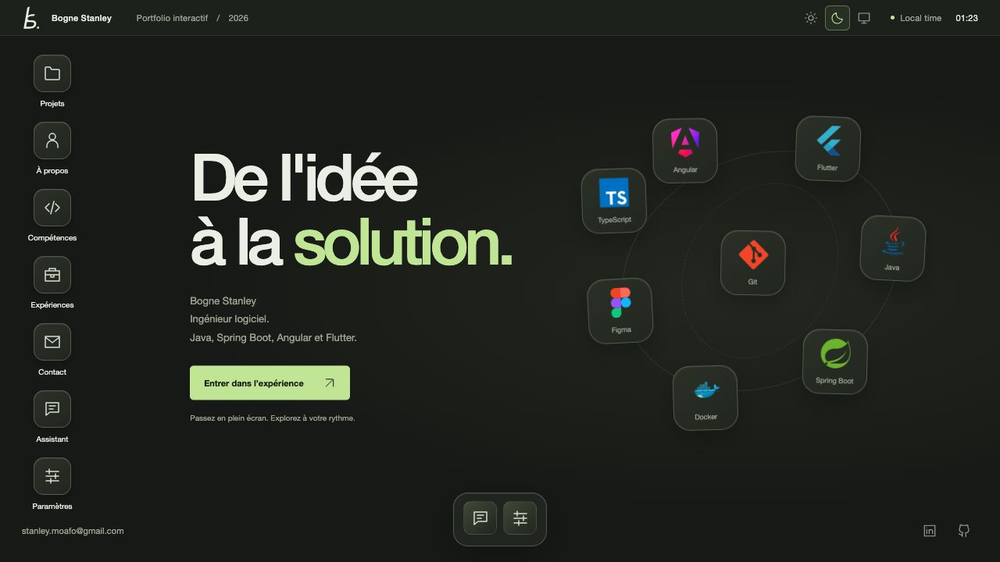

# Portfolio de Bogne Stanley

Un portfolio personnel imaginé comme un bureau interactif. Ouvrez les dossiers pour découvrir mes projets, mon parcours et mes compétences, ou échangez avec l’assistant pour en savoir plus sur moi.

## Une expérience à explorer

- Des fenêtres que l’on peut déplacer, redimensionner et disposer côte à côte.
- Une sélection de projets web et mobiles, de packages et de contenus pédagogiques.
- Un assistant qui répond aux questions à partir du portfolio.
- Des thèmes, des couleurs personnalisables et des animations réactives.
- Une interface adaptée au mobile, avec des dossiers en plein écran.

## Documentation

Les instructions de développement, de validation et de déploiement sont regroupées dans [docs](docs/README.md).
